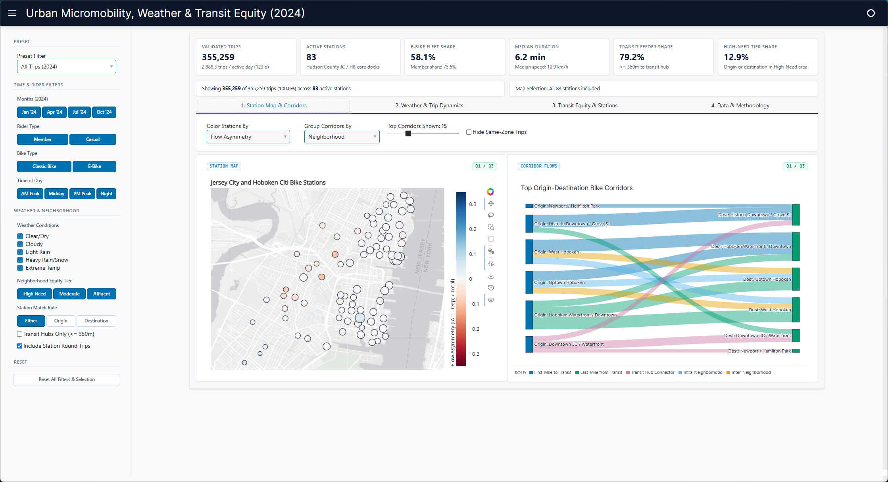
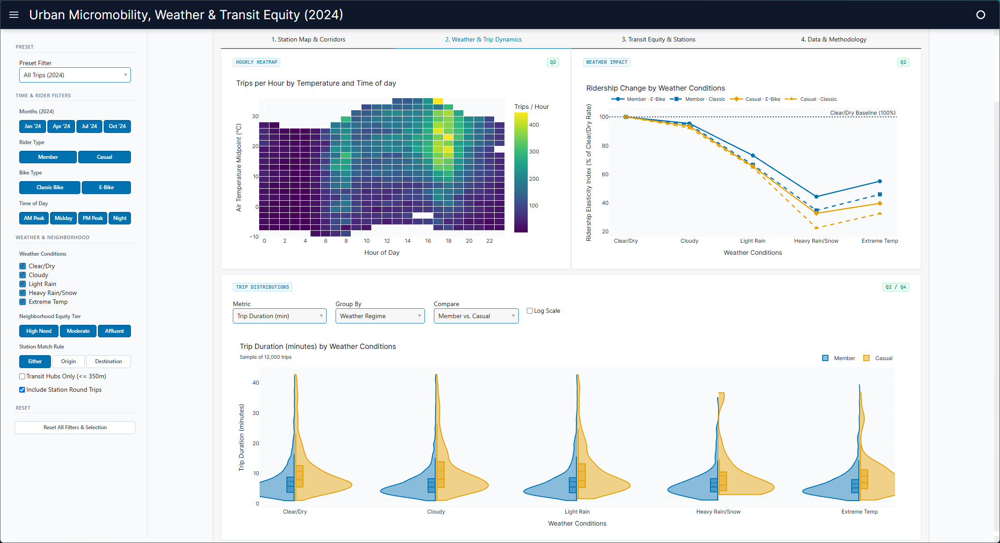
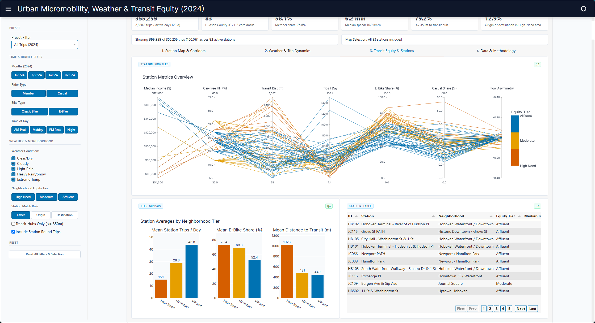

<div align="center">

# Urban Micromobility, Weather & Transit Equity

**Interactive visual analytics dashboard exploring 2024 Citi Bike demand, weather impact, and neighborhood transit equity across Jersey City & Hoboken**

[](https://github.com/zenzty/urban-micromobility-analytics/actions/workflows/ci.yml)


[](https://github.com/astral-sh/uv)
[](https://github.com/astral-sh/ruff)

[](https://panel.holoviz.org/)

[Dashboard Preview](#dashboard-preview) •
[Research Questions](#research-questions) •
[Data Sources](#data-sources) •
[Quick Start](#quick-start)

</div>

---

## Dashboard Preview

### 1. Station Map & Corridors
Web Mercator station map (`HoloViews` + `Bokeh` over Esri World Light Gray tiles) with tap, box-select, and lasso cross-filtering paired with an Origin-Destination `Plotly` Sankey diagram colored by rapid transit feeder role (`<= 350m` to transit hub).



### 2. Weather & Trip Dynamics
Hourly ridership heatmap across temperature and time of day (normalized by observed weather hours), weather impact line chart indexed against `Clear/Dry`, and split violin + interquartile box distributions comparing `Member` vs. `Casual` and `E-Bike` vs. `Classic Bike` trips.



### 3. Transit Equity & Stations
7-axis interactive Parallel Coordinates across Census tract income, car-free household share, distance to transit, daily rides, e-bike share, casual share, and flow asymmetry, alongside neighborhood tier summaries and a sortable `Tabulator` station table.



---

## Research Questions

| Tag | Question | Key Finding (2024 Seasonal Dataset) |
| :--- | :--- | :--- |
| **`Q1`** | **First/Last-Mile Transit Integration** | **79.2%** of trips start or end within `<= 350m` of a PATH, NJ Transit Light Rail, or Ferry terminal (`27.5%` first-mile to transit, `27.0%` last-mile from transit, `24.7%` hub-to-hub connectors). |
| **`Q2`** | **Weather Impact on Ridership** | Normalizing by observed weather hours, `Member` classic-bike demand stays at **66.6%** of its `Clear/Dry` hourly rate during `Light Rain` and **34.8%** during `Heavy Rain/Snow`, whereas `Casual` classic-bike demand drops to **22.5%**. |
| **`Q3`** | **Neighborhood Transit Equity** | Stations in `High Need` tracts (`14` docks; median income `$54.3k - $69.4k`) average **1,023m** from rapid transit hubs (vs. **449m** in `Affluent` waterfront areas) and show the highest **e-bike share (73.4%** vs. **52.4%** in `Affluent` tracts) to cover longer distances to transit. |
| **`Q4`** | **E-Bike vs. Classic Bike Usage** | Electric bikes account for **58.1%** of fleet rides and maintain higher median speeds and longer trip distances on uphill routes toward Journal Square, The Heights, and McGinley Square. |

---

## Data Sources

The ETL pipeline (`scripts/build_dataset.py`) integrates three public datasets across the four 2024 mid-season months (`202401` January, `202404` April, `202407` July, `202410` October - `123` active days):

| Dataset | Provider & Documentation | Scope & Join Key |
| :--- | :--- | :--- |
| **Citi Bike Trip Logs (`JC-` Slices)** | [Citi Bike System Data](https://citibikenyc.com/system-data), [S3 Bucket Index](https://s3.amazonaws.com/tripdata/index.html) | `360,527` raw records -> `355,259` validated rides (`5,268` / `1.46%` filtered via `DQ-01`–`DQ-04`) across `83` Jersey City (`JC*`) & Hoboken (`HB*`) stations. |
| **Historical Hourly Weather** | [Open-Meteo Historical Weather API](https://open-meteo.com/en/docs/historical-weather-api) ([Endpoint](https://archive-api.open-meteo.com/v1/archive)) | Hourly `temperature_2m`, `apparent_temperature`, `precipitation`, `wind_speed_10m`, `relative_humidity_2m`, and WMO `weather_code` at Jersey City centroid (`40.7282, -74.0776`) in `America/New_York`, joined on `started_at` floored to the hour. |
| **US Census ACS 5-Year & Transit Stops** | US Census Hudson County: [Income](https://data.census.gov/table/ACSDT5Y2024.B19013?g=050XX00US34017$1400000), [Car-Free HH](https://data.census.gov/table/ACSDT5Y2024.B08201?g=050XX00US34017$1400000), [Population](https://data.census.gov/table/ACSDT5Y2024.B01003?g=050XX00US34017$1400000) | Haversine distance matrix matching each station to its nearest Hudson County Census tract (`median_household_income`, `pct_car_free_households`, `population_density`, `equity_tier`) and nearest transit hub (`dist_to_transit_hub_m`). |

---

## Quick Start

### 1. Install Dependencies (`uv` + Python 3.12)
```powershell
uv sync
```

### 2. Build Processed Parquet Datasets
Downloads and caches the 2024 Citi Bike `.csv.zip` slices and Open-Meteo weather JSON in `data/raw/`, cleans and enriches the records, validates with `pandera`, and writes `data/processed/*.parquet`:
```powershell
uv run python scripts/build_dataset.py
```

> [!NOTE]
> Raw downloads are cached in `data/raw/`. Re-running `build_dataset.py` reuses local files unless `--force-download` is passed, or you can build a single month slice with `--months 202401`.

### 3. Launch the Dashboard
```powershell
uv run panel serve src/micromobility_analytics/ui/app.py --show --autoreload
```

> [!TIP]
> **PyCharm One-Click Run Configurations**: Open the repository in PyCharm to use the 5 pre-configured toolbar actions in `.idea/runConfigurations/`:
> - **`Run Dashboard`** - Starts the Panel server at `http://localhost:5006/app` with hot-reload
> - **`Build Dataset`** - Runs the full ETL pipeline (`scripts/build_dataset.py`)
> - **`Run Unit Tests`** - Runs the `pytest` suite (`39` unit tests)
> - **`Run Tests Coverage`** - Prints the line-by-line `pytest-cov` coverage report (`--cov=micromobility_analytics --cov-report=term-missing`)
> - **`Quality Gate`** - Runs `ruff check`, `ruff format --check`, `mypy`, and `pytest` sequentially

